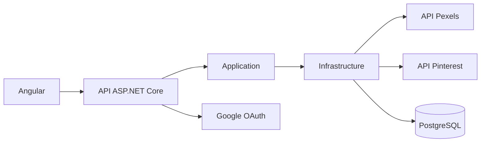

# Référence Dessin

Application web d’entraînement au dessin à partir de références photographiques. Elle permet de rechercher des images, de préparer une sélection et de réaliser des séances de dessin chronométrées.

**Application :** [app.reference-dessin.fr](https://app.reference-dessin.fr)

## Fonctionnalités

- Références photographiques Pexels : recherche par mot-clé et découverte d’images.
- Consultation des collections Pinterest proposées par l’application.
- Sélection d’images et préparation d’une séance de dessin.
- Minuteur configurable, navigation entre les images et passage automatique à l’image suivante.
- Raccourcis clavier, affichage agrandi et interface responsive.
- Attribution des photographes Pexels et liens vers les sources.
- Authentification Google et gestion du compte utilisateur.
- Gestion des erreurs de chargement et des limitations de requêtes.

## Technologies

| Backend | Frontend | Infrastructure |
|---|---|---|
| C#, .NET 10, ASP.NET Core | Angular 22, TypeScript | PostgreSQL 17 |
| Entity Framework Core, ASP.NET Core Identity | Angular Signals, RxJS | Docker Compose |
| HttpClient, OpenAPI | SCSS, Lucide Icons | Caddy, Cloudflare Tunnel |
| xUnit | Vitest | GitHub Actions, GHCR |

## Architecture



Le backend est organisé en quatre projets :

- **Application** : modèles, contrats et cas d’utilisation.
- **Infrastructure** : persistance, identité et intégrations Pexels et Pinterest.
- **Api** : contrôleurs HTTP, authentification et configuration de l’application.
- **Migrations** : application des migrations Entity Framework Core.

```text
ReferenceDessin/
├── Back/ReferenceDessin/
│   ├── src/
│   │   ├── ReferenceDessin.Api/
│   │   ├── ReferenceDessin.Application/
│   │   ├── ReferenceDessin.Infrastructure/
│   │   └── ReferenceDessin.Migrations/
│   └── tests/
├── Front/reference-dessin-web/
│   └── src/app/
│       ├── core/
│       └── features/
└── docker/
```

## Développement local

### Prérequis

- SDK .NET 10 ;
- Node.js 24 et npm ;
- Docker avec Docker Compose ;
- clé API Pexels ;
- identifiants OAuth Google ;
- identifiants Pinterest si cette intégration est activée.

### Base de données

Depuis la racine du dépôt, créer un fichier local non versionné `ReferenceDessin/docker/.env.dev` contenant `POSTGRES_PASSWORD` avec un mot de passe de développement.

```bash
cd ReferenceDessin/docker
docker compose --env-file .env.dev -f compose.dev.yaml up -d
```

### Backend

Depuis la racine du dépôt :

```bash
cd ReferenceDessin/Back/ReferenceDessin
```

Configurer les secrets locaux, en remplaçant les valeurs d’exemple :

```bash
dotnet user-secrets set "ConnectionStrings:Database" \
  "Host=localhost;Port=5432;Database=reference_dessin;Username=reference_dessin;Password=MOT_DE_PASSE_LOCAL" \
  --project src/ReferenceDessin.Api

dotnet user-secrets set "Pexels:ApiKey" "CLE_PEXELS" \
  --project src/ReferenceDessin.Api

dotnet user-secrets set "Authentication:Google:ClientId" "CLIENT_ID" \
  --project src/ReferenceDessin.Api

dotnet user-secrets set "Authentication:Google:ClientSecret" "CLIENT_SECRET" \
  --project src/ReferenceDessin.Api
```

Appliquer les migrations à la base de développement avant le premier démarrage. Le projet `ReferenceDessin.Migrations` utilise une chaîne de connexion fournie par variable d’environnement :

```bash
ConnectionStrings__Database='Host=localhost;Port=5432;Database=reference_dessin;Username=reference_dessin;Password=MOT_DE_PASSE_LOCAL' \
  dotnet run --project src/ReferenceDessin.Migrations
```

Démarrer l’API :

```bash
dotnet run --project src/ReferenceDessin.Api
```

L’API est disponible par défaut sur `http://localhost:5183`. Pour l’authentification Google, utiliser une URI de redirection autorisée correspondant à l’environnement local.

### Frontend

Depuis la racine du dépôt :

```bash
cd ReferenceDessin/Front/reference-dessin-web
npm ci
npm start
```

L’application est disponible sur `http://localhost:4200`. Le proxy Angular transmet les appels API au backend.

## API

Exemple de recherche Pexels :

```http
GET /api/photos?query=portrait&count=30
```

| Paramètre | Description |
|---|---|
| `query` | Thème facultatif ; sans valeur, photos sélectionnées par Pexels. |
| `count` | Nombre de photos, de 1 à 80 (30 par défaut). |

Les erreurs externes sont notamment traitées avec les statuts `502` et `504`. La recherche est également soumise à une limitation de requêtes par adresse IP (`429`). La documentation OpenAPI est disponible en développement.

## Tests

Depuis la racine du dépôt :

```bash
dotnet test ReferenceDessin/Back/ReferenceDessin/ReferenceDessin.sln
```

Pour le frontend :

```bash
cd ReferenceDessin/Front/reference-dessin-web
npm ci
npm test -- --watch=false
```

## Compilation

Depuis la racine du dépôt :

```bash
dotnet build ReferenceDessin/Back/ReferenceDessin/ReferenceDessin.sln \
  --configuration Release
```

Pour le frontend :

```bash
cd ReferenceDessin/Front/reference-dessin-web
npm run build
```

## Intégration et publication continues

- `dev` : branche d’intégration.
- `main` : branche de publication.
- [Intégration continue](.github/workflows/integration-continue.yml) : compilation et tests backend et frontend à chaque push et pull request.
- [Publication Docker](.github/workflows/publication-image.yml) : publication des images application et migrations sur GHCR lors des pushes sur `main`, pour AMD64 et ARM64.

Le déploiement en production utilise les images épinglées au SHA complet du commit publié. La publication des images ne constitue pas un déploiement automatique sur le serveur.

## Déploiement et exploitation

L’application est hébergée sur Raspberry Pi, avec PostgreSQL, Caddy et Cloudflare Tunnel. Une simulation locale de la production est également disponible avec Docker Compose.

Consulter la [documentation Docker et exploitation](ReferenceDessin/docker/README.md) pour les environnements, les configurations, le déploiement, le retour arrière, les sauvegardes, la restauration et les journaux.

## Sécurité et confidentialité

- Secrets et clés API conservés côté serveur, hors du dépôt Git.
- HTTPS en production et vérification TLS entre Cloudflare Tunnel et Caddy.
- Authentification par cookies et protection antifalsification des requêtes.
- Validation des paramètres API et limitation des requêtes Pexels.
- Politique de confidentialité accessible depuis l’application.
